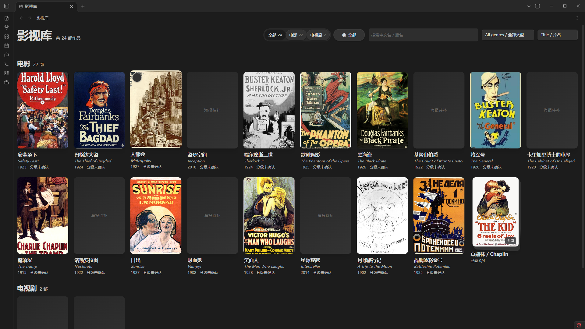
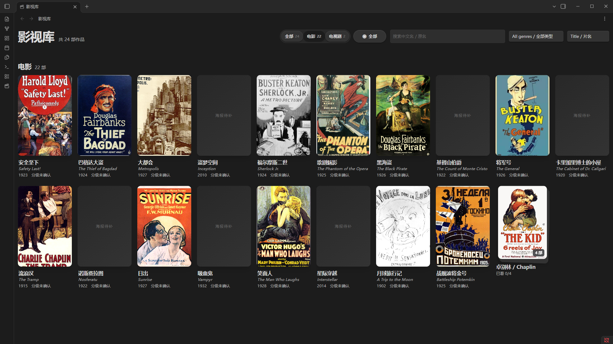
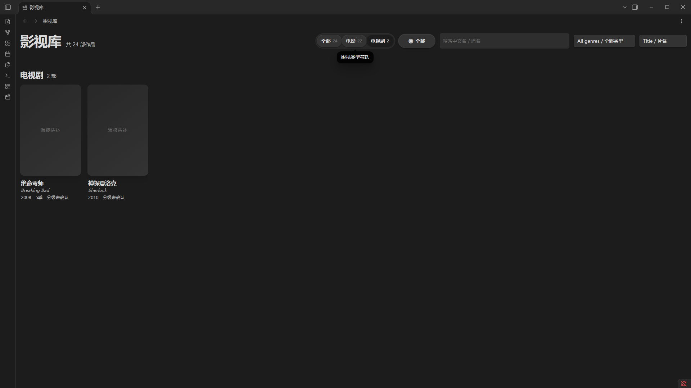
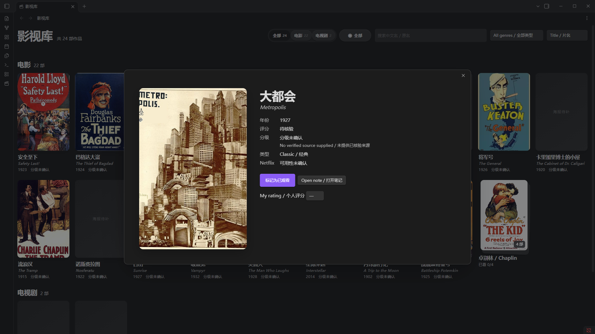
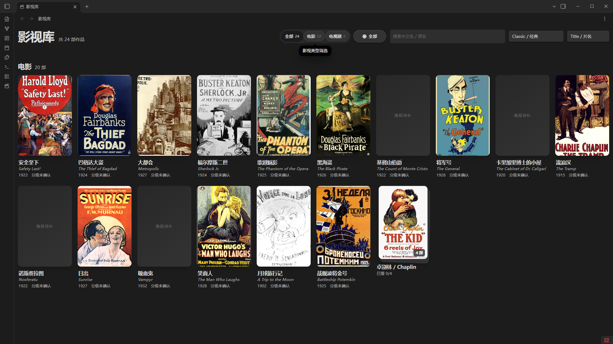
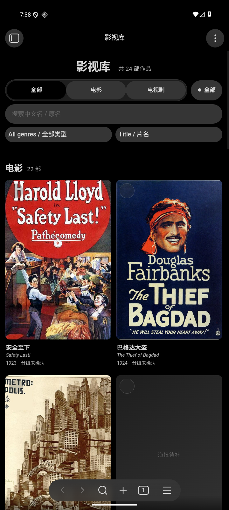
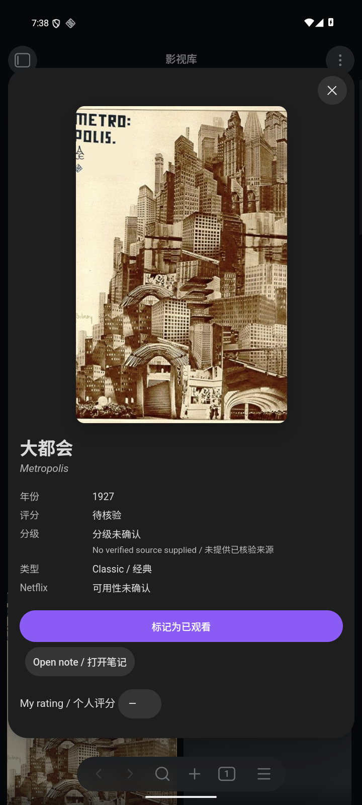
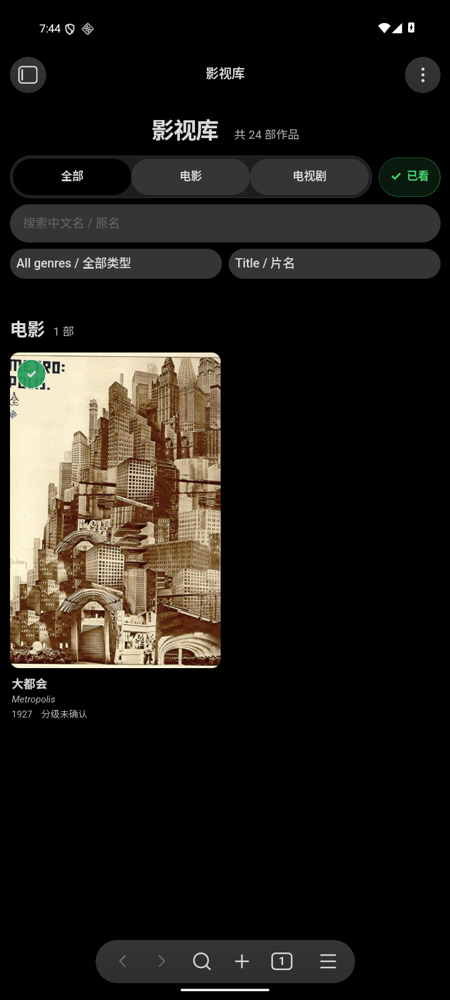

# Obsidian Media Library Builder

**An original open-source project by brianXx123.** Turn your own movie and TV list into an Obsidian library with an AI Skill, protected Markdown notes and the author's native Movie Wall implementation.

[English](README.md) · [简体中文](README.zh-CN.md) · **0.3.0 preview**

[Release downloads / 下载](https://github.com/brianXx123/obsidian-media-library-builder/releases) · [Schema & recovery / 字段与恢复](references/schema.md) · [Source comparison / 原版比对](docs/ORIGINAL-INTEGRATION.md) · [Validation / 验收](docs/VALIDATION-v0.3.0.md) · [Artwork / 海报来源](docs/ARTWORK.md)

## Real software

These are actual Windows Obsidian 1.14.5 screenshots of the isolated 24-work demo with plugin 0.3.0. Sixteen historical posters have file-specific public-domain evidence; the other eight works use the real missing-poster fallback. No artwork sources are shipped. Modern blockbuster posters were omitted where display permission could not be confirmed. [Capture records](docs/screenshots/metadata.json).



| Movies / 电影 | Series / 电视剧 |
|---|---|
|  |  |
| Detail / 详情 | Filter / 筛选 |
|  |  |

[Markdown note / 笔记](docs/screenshots/desktop-note.png) · [Light theme / 浅色主题](docs/screenshots/desktop-light.png)


| Android library / 安卓海报墙 | Detail / 详情 | Watched filter / 观看筛选 |
|---|---|---|
|  |  |  |

Android captures: actual Obsidian Mobile 1.14.4 on Android 16/API 36 emulator, 720×1600 original portrait pixels. / Android 16 模拟器中真实 Obsidian Mobile 1.14.4，原始竖屏 720×1600。

## What it does

- Imports UTF-8 CSV/JSON into a catalog, Obsidian links and individual notes; repeat imports preserve edited notes and reject conflicts.
- Integrates the author's mature Movie Wall 1.5.0: responsive posters, title/original-name search, movies/TV, collections, season dialogs and watched-season progress, keyboard and touch navigation.
- Adds genre filtering, title/year/rating sorting, direct note opening, personal ratings, safe local artwork handling and plugin upgrade backups.
- Stores runtime watch status and ratings in note frontmatter; continues reading legacy 0.2 watch overrides.
- Includes isolated demo generation, bilingual instructions and reproducible, extracted-and-tested release packages.

## Install the AI Skill

Download `obsidian-media-library-builder-v0.3.0.skill` from Releases. It is a ZIP-format Skill bundle with one `obsidian-media-library-builder/` directory. Extract it into your agent's supported skills directory (for Codex, `$CODEX_HOME/skills` or `~/.codex/skills`). Reload skill discovery. A `.skill` upload button is host-specific; extraction works for directory-based agents. Python 3.10+ must be executable by the agent.

Example request: “Use obsidian-media-library-builder to build a movie and TV library in my new vault from my CSV. Keep existing notes and use my local posters.” The agent uses [SKILL.md](SKILL.md), inspects your input, runs a dry run, imports and installs the plugin. Supply the actual vault and list paths; this is not a desktop film player or a hosted website.

## Quick start and plugin installation

Clone/download the repository and run from its root:

```bash
python scripts/media_library.py import --vault "./My Vault" --input examples/sample.csv --dry-run
python scripts/media_library.py import --vault "./My Vault" --input examples/sample.csv
python scripts/media_library.py validate --vault "./My Vault"
python scripts/media_library.py install-plugin --vault "./My Vault"
```

Open `My Vault` in Obsidian. Enable **Media Library Wall** in **Settings → Community plugins**, then use the clapperboard ribbon or **Open Media Library / 打开影视库**. For manual installation, extract `media-library-wall-v0.3.0.zip` into `<vault>/.obsidian/plugins/media-library-wall/`. Its root contains `main.js`, `manifest.json`, `styles.css`. These files are also separate release attachments. Close Obsidian before upgrades; `install-plugin --upgrade` backs up the prior plugin files locally.

Use your own CSV/JSON instead of `examples/sample.csv`. Only `title` is required. [Full fields](references/schema.md) include stable `id`, `type`, `year`, `genres`, `poster`, `seasons` and collection fields. A poster path is vault-relative, for example `Media Library/posters/film.jpg`. No API key is required.

For a fresh 24-title demo: `python scripts/create_demo.py --vault "./Demo Vault"`. Optional `--poster-source "LOCAL POSTER DIRECTORY"` copies authorized local `demo-NN` images; otherwise placeholders are expected. See artwork provenance for filenames and rights. The command refuses a nonempty destination.

## Scope and limitations

The original JavaScript and CSS were found, audited and integrated; no TypeScript/build source was found in the bounded original-source search. This is not a claim to reproduce all private enrichment scripts. Existing private Chinese-layout vaults are not automatically migrated. Version 0.2 note layouts can be read; changed import schemas/metadata may need explicit conflict resolution before a rerun. Do not enable both old and new wall plugins against the same media data.

The UI retains Chinese original Movie Wall labels; primary new controls and all setup documentation are bilingual. The CLI imports basic season rows and collections, not every original advanced field. Imported metadata updates deliberately stop on conflicts. There is no TMDB matching, poster downloader, automatic streaming-availability check, full metadata editor or full grid virtualization. Artwork and public scores must be supplied lawfully; unknown values remain unknown. Deletion requires an in-app confirmation, uses Obsidian trash and records tombstones; keep backups, especially during bulk edits.

## Verification and support

Python 3.10+; plugin minimum Obsidian 1.5.0. Native desktop tested on Windows with Obsidian 1.14.5. Android 16 emulator with Obsidian Mobile 1.14.4 also passed library, detail, filtering, note opening and watch/season persistence. Exact results are in the [validation report](docs/VALIDATION-v0.3.0.md); macOS, Linux desktop and iOS native UI are **NOT RUN**. GitHub Actions separately tests Windows/Linux CLI and plugin contracts. Automated tests never substitute for actual app acceptance.

```bash
python -m unittest discover -s tests -v
node --check plugin/main.js
node --test tests/*.cjs
python scripts/build_release.py
```

This is a GitHub pre-release, not stable 1.0 or an Obsidian Community Plugins listing. The planned numeric tag `0.3.0` matches the manifest for plugin compatibility. Directory submission remains a separate review process. [Release guide](docs/RELEASE-GUIDE.md) · [Release notes](docs/RELEASE-NOTES-v0.3.0.md).

## License and contribution

[MIT](LICENSE) covers project code and documentation; screenshot artwork retains its documented status. No private vault, author watch history, poster source or API key is bundled. Contributions should include relevant tests and honest environment evidence. [Contributing](CONTRIBUTING.md) · [Security](SECURITY.md).
