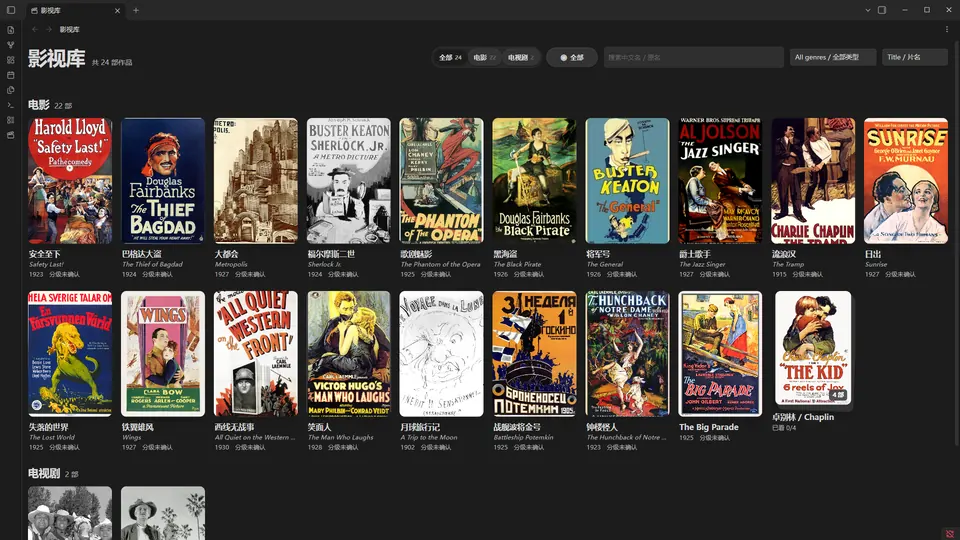
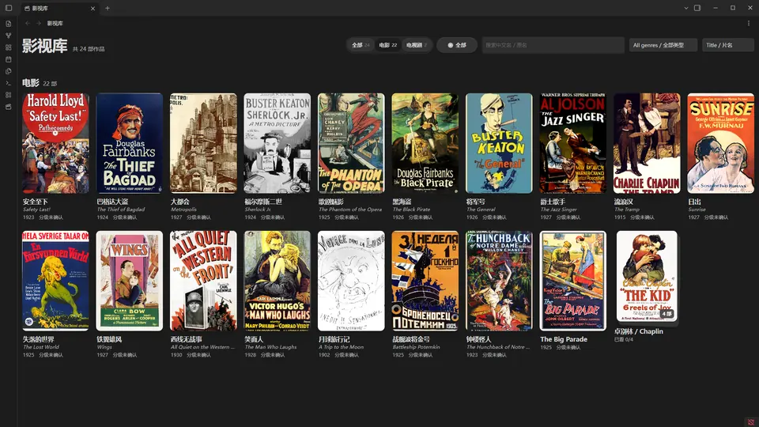
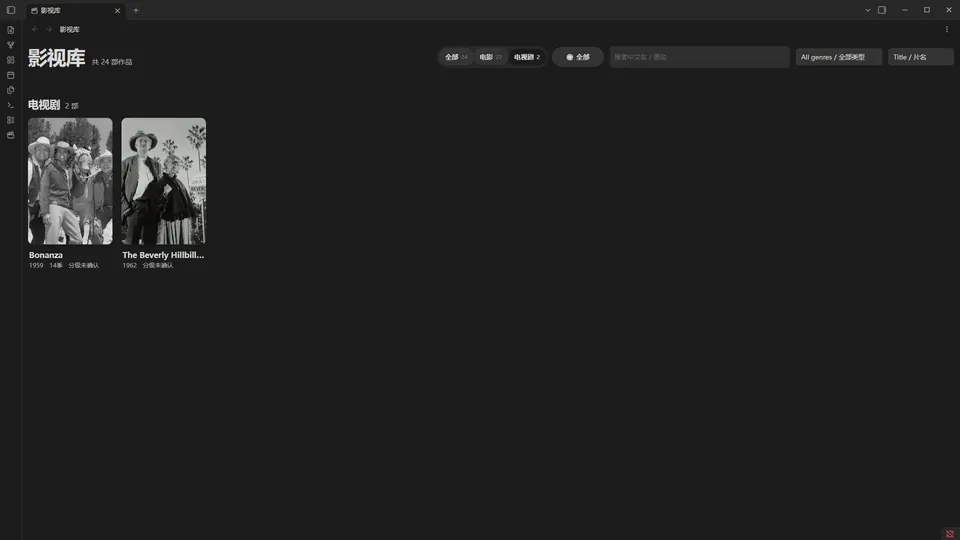
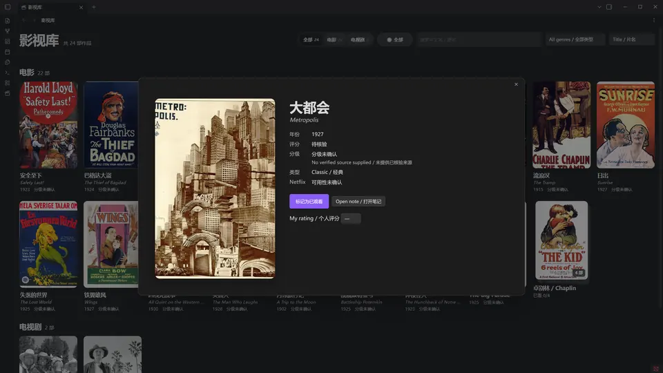
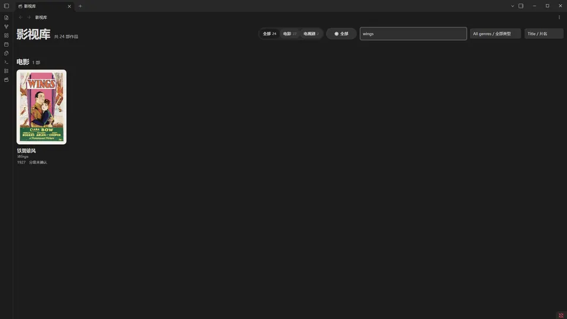
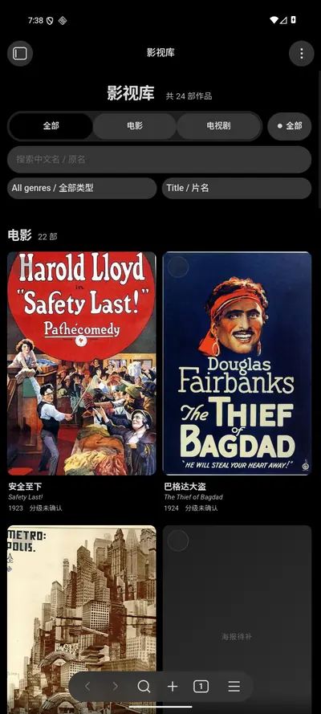
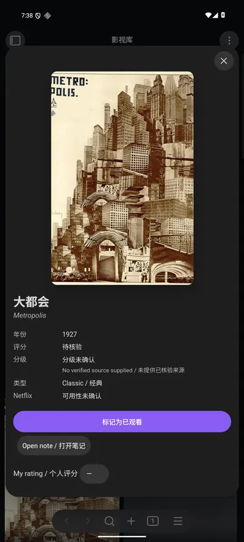
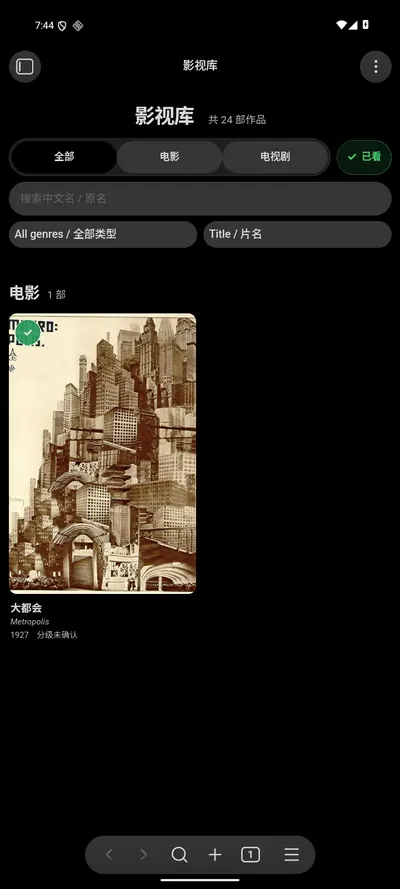

# Obsidian Media Library Builder

**由 brianXx123 原创的开源项目。** 通过 AI Skill、受保护的 Markdown 笔记和作者原版 Movie Wall 插件，将自己的电影、电视剧片单构建为 Obsidian 影音库。

[English](README.md) · [简体中文](README.zh-CN.md) · **0.3.1 预览版**

[](https://github.com/brianXx123/obsidian-media-library-builder/actions/workflows/ci.yml)
[](https://github.com/brianXx123/obsidian-media-library-builder/releases)
[](LICENSE)

## 快速开始 / Get started

| **AI Skill（推荐）** | **Obsidian 海报墙插件** |
|---|---|
| [**下载 AI Skill 0.3.1**](https://github.com/brianXx123/obsidian-media-library-builder/releases/download/0.3.1/obsidian-media-library-builder-v0.3.1.skill) | [**下载插件 ZIP 0.3.1**](https://github.com/brianXx123/obsidian-media-library-builder/releases/download/0.3.1/media-library-wall-v0.3.1.zip) |
| 交给 AI 创建影音库、导入片单并安全安装插件。 | 在已有兼容 Obsidian 库中安装原生 Movie Wall。 |

**从这里开始：** [安装教程](#安装-ai-skill) · [常见问题 FAQ](docs/FAQ.md) · [完整 0.3.1 Release](https://github.com/brianXx123/obsidian-media-library-builder/releases/tag/0.3.1)

> **技术预览版，不是 1.0 稳定版：** 已有真实 Windows 和 Android 模拟器运行记录；高级导入、迁移和部分原生平台尚未完成验收。以下截图为实际运行画面，并非 AI 概念图。


[Release downloads / 下载](https://github.com/brianXx123/obsidian-media-library-builder/releases) · [Real screenshot gallery / 真实截图演示](docs/SHOWCASE.md) · [Schema & recovery / 字段与恢复](references/schema.md) · [Source comparison / 原版比对](docs/ORIGINAL-INTEGRATION.md) · [Validation / 验收](docs/VALIDATION-v0.3.1.md) · [Artwork / 海报来源](docs/ARTWORK.md)

## 真实软件截图

截图来自 Windows Obsidian 1.14.5 中真实运行的插件 0.3.1，以及隔离的 24 部作品演示库。桌面演示24部作品全部有真实图片：22张电影海报与2张官方剧集宣传照，均有逐文件公有领域依据。缺少已核实图片的条目已在桌面片单中替换；源图片不随项目发布。[拍摄记录](docs/screenshots/metadata.json)。

[](docs/screenshots/desktop-library.png)

<details>
<summary><strong>桌面功能细节 / Desktop features（点击展开）</strong></summary>

| Movies / 电影 | Series / 电视剧 |
|---|---|
| [](docs/screenshots/desktop-movies.png) | [](docs/screenshots/desktop-series.png) |
| Detail / 详情 | Filter / 筛选 |
| [](docs/screenshots/desktop-detail.png) | [](docs/screenshots/desktop-filter.png) |

[Markdown note / 笔记](docs/screenshots/desktop-note.png) · [Light theme / 浅色主题](docs/screenshots/desktop-light.png) · [Actual-screenshot slideshow GIF / 桌面截图轮播](docs/screenshots/previews/desktop-screenshot-tour.gif)

</details>


| Android library / 安卓海报墙 | Detail / 详情 | Watched filter / 观看筛选 |
|---|---|---|
| [](docs/screenshots/mobile-library.png) | [](docs/screenshots/mobile-detail.png) | [](docs/screenshots/mobile-filter.png) |

**Mobile screenshot slideshow / 移动端截图轮播:** [GIF preview (real captured frames, not a screen recording)](docs/screenshots/previews/mobile-screenshot-tour.gif). These WebP images are compressed thumbnails; click the [original screenshot directory](docs/screenshots/) for full-resolution PNG evidence. / WebP 为压缩预览，原始 PNG 及证据保持不变。

按用户要求，移动截图逐字节保留自插件0.3.0，使用此前独立演示片单。Android captures: actual Obsidian Mobile 1.14.4 on Android 16/API 36 emulator, 720×1600 original portrait pixels. / Android 16 模拟器中真实 Obsidian Mobile 1.14.4，原始竖屏 720×1600。

## 已实现功能

- UTF-8 CSV/JSON 导入、目录、Obsidian 索引和作品笔记；重复导入保留编辑内容，冲突时拒绝覆盖。
- 整合作者成熟 Movie Wall 1.5.0：响应式海报墙、中英文片名搜索、电影/剧集分类、合集、季详情、季级观看进度、键盘及触摸导航。
- 补充类型筛选、片名/年份/评分排序、笔记跳转、个人评分、本地海报校验和插件升级备份。
- 观看状态、观看季和个人评分保存到笔记属性；继续读取 0.2 版观看状态覆盖文件。
- 提供隔离演示库生成、双语指引及可重复构建、解压安装验证的发布包。

## 安装 AI Skill

从 Release 下载 `obsidian-media-library-builder-v0.3.1.skill`。这是 ZIP 格式 Skill 包，内含一个 `obsidian-media-library-builder/` 目录。将其解压到 AI 客户端支持的技能目录；Codex 通常使用 `$CODEX_HOME/skills` 或 `~/.codex/skills`，然后重新加载技能。是否直接支持 `.skill` 上传取决于客户端；目录安装模式可以解压使用。AI 环境需能执行 Python 3.10+。

示例请求：“使用 obsidian-media-library-builder，根据我的 CSV 在新 Obsidian 库中建立电影和电视剧影音库，保留已有笔记，使用我本地的海报。” AI 会读取 [SKILL.md](SKILL.md)，检查资料、预检、导入并安装插件。需要提供实际目标库和片单路径；项目运行载体是 Obsidian。

## 快速开始与插件安装

下载或克隆仓库，在仓库根目录执行：

```bash
python scripts/media_library.py import --vault "./My Vault" --input examples/sample.csv --dry-run
python scripts/media_library.py import --vault "./My Vault" --input examples/sample.csv
python scripts/media_library.py validate --vault "./My Vault"
python scripts/media_library.py install-plugin --vault "./My Vault"
```

在 Obsidian 打开 `My Vault`，通过 **设置 → 第三方插件** 启用 **Media Library Wall**，再点场记板图标或执行 **Open Media Library / 打开影视库**。手动安装时，将 `media-library-wall-v0.3.1.zip` 的三个根文件解压到 `<库>/.obsidian/plugins/media-library-wall/`：`main.js`、`manifest.json`、`styles.css`；Release 也提供独立附件。升级前关闭 Obsidian，使用 `install-plugin --upgrade` 自动备份旧插件文件。

将 `examples/sample.csv` 换成自己的 CSV/JSON。只有 `title` 必填，[完整字段](references/schema.md) 支持固定 `id`、`type`、`year`、`genres`、`poster`、`seasons` 和合集字段。海报使用库内相对路径，例如 `Media Library/posters/film.jpg`；无需 API 密钥。

新建 24 部作品演示库：`python scripts/create_demo.py --vault "./Demo Vault"`。可选 `--poster-source "本地海报目录"` 复制已有授权的 `demo-NN` 图片；未提供时显示占位。图片文件名和许可见来源记录。目标目录非空时拒绝运行。

## 范围与已知限制

已找到并审查原 JavaScript/CSS 后整合；有界搜索未找到 TypeScript/构建源码。本版不声称复现所有私人资料丰富脚本，也不自动迁移原中文路径私人库。可读取 0.2 版笔记布局，但旧导入字段或元数据变化可能需明确处理冲突。不要让原插件与新插件同时操作同一批媒体数据。

保留原版中文界面标签，新主要控件及安装文档提供双语支持。CLI 导入基础季记录和合集，未覆盖原版全部高级字段；已有元数据更新遇冲突会停止。尚无 TMDB 自动匹配、海报自动下载、流媒体可用性自动核验、完整元数据编辑器及完整网格虚拟化。图片与公共评分由用户合法提供，不明信息留空。删除需应用内确认，通过 Obsidian 回收站并记录墓碑；批量操作前请备份。

## 验证与支持

Python 3.10+，插件最低 Obsidian 1.5.0。已在 Windows Obsidian 1.14.5 进行真实桌面验收；保留的0.3.0移动验收中，Android 16 模拟器的 Obsidian Mobile 1.14.4 已通过海报墙、详情、筛选、笔记跳转和观看/季状态持久化验收，准确结论见[验证报告](docs/VALIDATION-v0.3.1.md)。macOS、Linux 桌面及 iOS 原生界面均为 **NOT RUN**。GitHub Actions 单独验证 Windows/Linux CLI 和插件契约；自动化测试不能替代真实应用验收。

```bash
python -m unittest discover -s tests -v
node --check plugin/main.js
node --test tests/*.cjs
python scripts/build_release.py
```

项目以 GitHub 预发布形式分发，尚非 1.0 稳定版或 Obsidian 插件商店上架项目。计划标签 `0.3.1` 与 manifest 一致；社区商店仍需单独审核。[发布指南](docs/RELEASE-GUIDE.md) · [发布说明](docs/RELEASE-NOTES-v0.3.1.md) · [FAQ 常见问题](docs/FAQ.md)。

## 许可与贡献

代码及文档使用 [MIT](LICENSE)；截图中海报保留各自来源声明。发布包不含私人库、作者观看历史、海报源文件或密钥。贡献请附相关测试和真实环境证据。[贡献](CONTRIBUTING.md) · [安全](SECURITY.md)。
