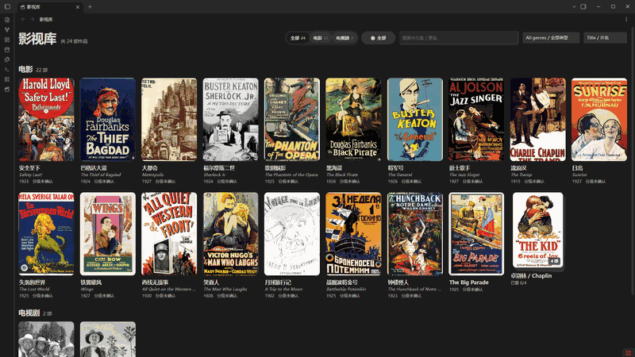
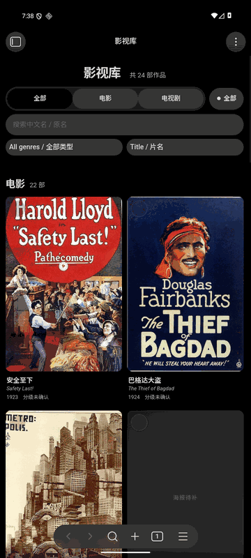

# Real Obsidian showcase / 真实运行演示

[English](#english) · [简体中文](#简体中文)

## English

All media below were derived from **actual captured Obsidian screens**, not image-model renders.

- **Desktop:** Windows Obsidian 1.14.5, plugin 0.3.1, a public 24-work demonstration Vault.
- **Mobile:** Android 16 / API 36 emulator, Obsidian Mobile 1.14.4, plugin 0.3.0. The mobile capture set is intentionally retained from the earlier demo and is not claimed to be from the 0.3.1 desktop list.
- **Source evidence:** [original PNG screenshots and SHA-256 metadata](screenshots/), [verification report](VALIDATION-v0.3.1.md), [artwork provenance](ARTWORK.md).

### Desktop — screenshot slideshow

The GIF cycles through three **still** screenshots (wall, detail and filter). It is **not a recording of actual clicking or scrolling**, and it contains no AI-created or composited interface.

[Open full-resolution desktop library](screenshots/desktop-library.png) · [Detail](screenshots/desktop-detail.png) · [Filter](screenshots/desktop-filter.png) · [All screenshots](screenshots/metadata.json)

### Android — screenshot slideshow

The three mobile frames are from the actual Obsidian Mobile emulator; the slideshow animation only changes between recorded still frames.

[Original Android wall](screenshots/mobile-library.png) · [Detail](screenshots/mobile-detail.png) · [Watched filter](screenshots/mobile-filter.png)

### About the images

Full-resolution original PNG images are preserved byte-for-byte. README thumbnails are downscaled WebP derivatives regenerated using `python scripts/make_showcase.py`; the script verifies each original's SHA-256 against metadata before producing any output.

Image sources in the separate demo Vault are not part of the plugin or Skill packages. Copyright statements are file- and jurisdiction-dependent; consult [ARTWORK.md](ARTWORK.md).

## 简体中文

这里展示的是 **Obsidian 实际运行截图制作的展示轮播**，不是 AI 想象的界面，不是伪造的软件操作视频。

- **桌面版：** Windows Obsidian 1.14.5，插件 0.3.1，独立 24 部影视作品演示库。
- **移动端：** Android 16 / API 36 模拟器、Obsidian Mobile 1.14.4，插件 0.3.0。原始移动截图按先前要求保留，没有冒充新版桌面片单。
- **证据：** [截图源文件与 SHA-256](screenshots/metadata.json)、[验收记录](VALIDATION-v0.3.1.md)、[素材来源](ARTWORK.md)。

两个 GIF 只是三张原始静态截图的轮播，**不是用户点击、滚动和切换页面的真实录屏**。如需宣传实际交互，需要另行录制真实 Obsidian 使用视频。

所有 PNG 原图保持原样；仅新增尺寸更小的 WebP 和 GIF 作为展示衍生图，源海报不随公开安装包发布。图片授权需结合具体来源与使用法域核查。
